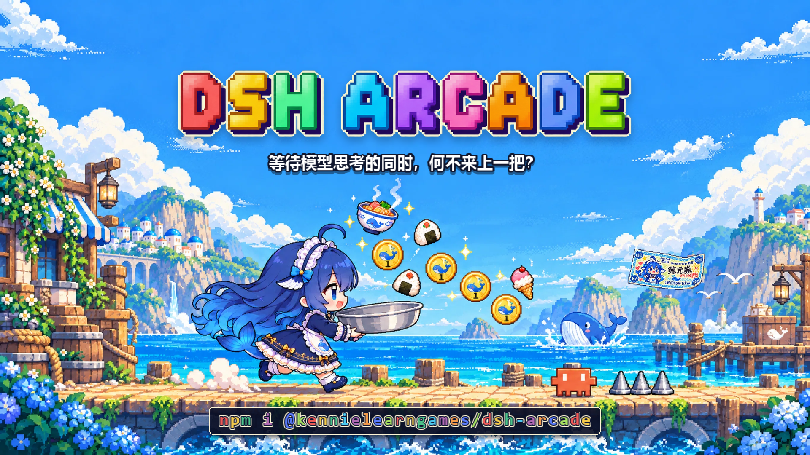

# 🕹️ dsh-arcade



### 等模型思考的那几十秒，也可以有点意思。

**dsh-arcade** 是给 [DeepSeek Harness](https://github.com/deepseek-ai/deepseek-harness) 做的街机小游戏插件。

模型开始思考时，输入框左侧会安静地出现一个入口——可能是跑动的小女仆，也可能是一架线框战机。点一下，输入框上方直接开一局：跑寿司、踩螃蟹、躲竹子，或者驾驶战机在深空里迎击敌机、捡奖励、挑战 BOSS。关掉就回到对话，不打断你的思路，也不抢输入焦点。

现在有两款游戏：**寿司跑酷** 和 **深空突袭**。在 **DSH 设置 → `dsh-arcade`** 里切换，选择会保存在本地。

[](https://www.npmjs.com/package/@kennielearngames/dsh-arcade)
[](LICENSE)
[](https://github.com/deepseek-ai/deepseek-harness)

---

## ✨ 能玩到什么

| | |
|---|---|
| 👧 **入口即游戏** | 模型思考时，输入框左侧出现当前游戏的入口：小女仆或线框战机。点开即玩，关闭即走。 |
| 🏃 **寿司跑酷** | 无尽跑酷，速度从 20 爬到 200 km/h：寿司、Token 硬币、鲸元券、竹子、尖刺、深坑、小螃蟹、无敌星。 |
| 🚀 **深空突袭** | 半圆轨道线框射击：自动开火、机头弹道、玩家 HP、小兵/精英/BOSS 分层血量、概率奖励掉落、BOSS 蓄力激光。 |
| 🎁 **八种奖励** | 双弹道、三弹道、伤害（可叠 3 层）、射速（可叠 3 层）、穿透、护盾（破碎前永久）、修复、清屏。 |
| 🌗 **明暗双主题** | 浅色黑线稿 / 深色白线稿实时切换；入口、面板、游戏共用一套主题。 |
| ⚡ **轻量、随开随玩** | 纯 DOM/CSS + Canvas，无音效、无外部请求；只有打开时才跑循环，关闭立即释放。 |

**不抢输入焦点，不弹窗打断，也不上传任何游戏数据。** 只是一小块能让你在等待时松口气的街机厅。

## 🚀 安装

### 推荐：在 DSH 插件里安装

在 DeepSeek Harness 的 **插件 / Plugin Manager** 中安装 bundle：

```
@kennielearngames/dsh-arcade
```

### 手动安装（profile 方式）

在 `~/.dsh/profiles/<profile>/package.json` 里加入：

```json
{
  "dependencies": {
    "@kennielearngames/dsh-arcade": "^0.3.0"
  },
  "dsh": {
    "profile": {
      "bundles": [
        "@kennielearngames/dsh-arcade"
      ]
    }
  }
}
```

然后重启 DSH，或在 profile 目录用 CLI 添加：

```bash
dsh plugin --profile desktop add @kennielearngames/dsh-arcade
```

## 🕹️ 怎么玩

开一个任务，等模型开始思考时，**点输入框左侧的入口**，输入框上方直接开始游戏。

**切换游戏**：打开 **DSH 设置 → `dsh-arcade`**，选择「寿司跑酷 / 深空突袭」。入口会立刻换成对应的图标，选择会保存在 `localStorage`。

### 寿司跑酷

| 操作 | 作用 |
|---|---|
| `空格` / `↑` / `W` / 点击游戏区 | 跳跃（跳尖刺、跳坑、踩螃蟹） |
| `↓` / `S` | 下蹲 / 滑铲（钻竹子；空中按会快速下落） |
| `Esc` / 右上角 × | 关闭游戏（模型仍在思考时，入口会回到输入框左侧） |

小提示：竹子只能蹲过去，跳跃会撞头；螃蟹要**落下去踩**，从下面跑过去会撞上。

### 深空突袭

| 操作 | 作用 |
|---|---|
| `←` / `→` / `A` / `D` | 沿半圆轨道左右移动，机体随之压弯 |
| 自动开火 | 从机头持续射击，无需按键 |
| `Esc` / 右上角 × | 关闭游戏 |

- 玩家 HP 100；小兵、精英、BOSS 血量各不相同，击坠有概率掉落奖励。
- 奖励：双弹道、三弹道、伤害（3 层）、射速（3 层）、穿透、护盾、修复、清屏。
- BOSS 会瞄准你、侧移/后退躲避，并蓄力发射大范围高伤害激光。

## 🧩 项目结构

```
dsh-arcade/
├─ index.js              # 宿主半：/arcade/* 诊断路由 + 激活日志
├─ client.js             # 构建产物：浏览器 bundle（游戏全部逻辑与素材）
├─ cordis.patch.yml      # 把插件行插入 DSH profile
├─ src/
│  ├─ engine.js          # 寿司跑酷：物理、生成器、金币/鲸元券、竹子/尖刺/坑/小螃蟹
│  ├─ shooter.js         # 深空突袭：半圆轨道、HP/奖励/BOSS AI/激光
│  ├─ settings.js        # DSH 设置里的 dsh-arcade 游戏选择分区
│  ├─ panel.js           # React 面板 + HUD + 键鼠输入
│  ├─ styles.js          # 全部 CSS（sr- 前缀，明暗主题 token）
│  └─ client.js          # 插件接线：思考状态监听、slot 注册、主题同步、入口
├─ assets/shooter/       # 战机/敌机/BOSS/奖励图标线稿（黑白双主题）
├─ assets/branding/      # 像素海岸背景、像素标题、生成的 Banner
├─ tools/                # 构建、素材烘焙、Banner、无浏览器断言
└─ preview/              # 离线预览页（不依赖 DSH）
```

## 🛠️ 开发

```bash
git clone https://github.com/zhangyuzhangyu233/dsh-arcade.git
cd dsh-arcade
npm install

npm run build         # 重建 client.js + preview/bundle.js（含 shooter 素材烘焙）
npm run build:shooter # 只重新生成战机/奖励 SVG 模块
npm run check         # 无浏览器引擎断言（拾取物/货币/障碍/无敌/Buff/动画节奏）
```

离线预览（不启动 DSH，直接在浏览器打开）：

```
preview/index.html?theme=dark&jump=1&sim=3000
preview/index.html?theme=light&hazard=1
preview/index.html?theme=dark&slide=1
```

修改原始美术素材后重新烘焙（需要 Python + Pillow）：

```bash
python tools/build-assets.py
```

重新生成 README / Social Banner：

```bash
python tools/make-banner.py
```

> `client.js` 与 `src/generated/*` 是提交进仓库的构建产物；只改引擎/面板/样式时不需要重新烘焙素材。

## 🗺️ Roadmap

dsh-arcade 不打算只做一款游戏。目标是把它慢慢长成 DSH 里的「街机架」：

- [x] v0.1 寿司跑酷
- [x] v0.2 入口女仆 / 铺路开场 / 无边框游戏区
- [x] v0.3 深空突袭（线框战机、奖励道具、BOSS 激光）+ DSH 设置内切换游戏
- [ ] Arcade Shell：统一 HUD / 最高分 / 每日挑战
- [ ] 敲 Token（打地鼠式点击小游戏）
- [ ] 接寿司 / 寿司蛇
- [ ] Token Breakout、弹幕「深度求索中」
- [ ] 跨游戏 Token 与皮肤收集（纯外观，无数值付费）

## 🤝 贡献

**如果有什么想玩的游戏，直接提 Issue 就好；如果你有不错的游戏想法，也欢迎来贡献这个项目。**

- 想加游戏 / 改手感 / 报 Bug：开 [Issue](https://github.com/zhangyuzhangyu233/dsh-arcade/issues)。
- 想直接写代码：欢迎 [Pull Request](https://github.com/zhangyuzhangyu233/dsh-arcade/pulls)，从 `src/` 改起即可，提交前跑一下 `npm run check`。
- 喜欢这个项目的话，点个 Star 就是最好的鼓励 ⭐

## ⚖️ 授权与声明

- 代码以 [MIT](LICENSE) 开源。
- 这是一个**粉丝向项目**，与 Anthropic、DeepSeek 无隶属关系。DeepSeek / DeepSeek Harness 相关名称归深度求索所有；Claude / Claude Code 名称与标志归 Anthropic 所有。像素与矢量美术素材随仓库提供，仅供本项目使用；如有权利问题请开 Issue 联系。
- 游戏内所有分数、最高分和当前游戏选择只存在浏览器 `localStorage`，不上传任何数据。

---

### English

**dsh-arcade** is a tiny arcade for [DeepSeek Harness](https://github.com/deepseek-ai/deepseek-harness).

While the model is thinking, a small entry appears left of the composer — a running maid or a line-art fighter. Click it to play above the input box: a pixel sushi runner (sushi, token coin trails, crabs, bamboo, spikes, pits) or a wireframe deep-space fighter (HP, elites, a dodging laser boss, eight reward pickups). Close it and you're back to the conversation.

Two games ship today, and you switch between them under **Settings → `dsh-arcade`**; the choice is stored locally. Pure DOM/CSS + Canvas, no audio, no external requests, no data uploaded.

**Contributing:** if there's a game you want to play, just open an issue. If you have a good idea for a game, contributions are very welcome — PRs are reviewed with love.

MIT licensed. Fan project, not affiliated with Anthropic or DeepSeek.
